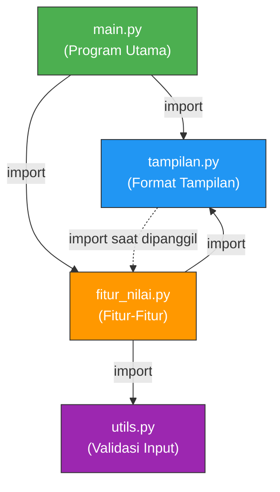

# 📚 SIPENA — Sistem Pencatatan Nilai Akhir

> **Tugas Akhir MORRIS Teknik Informatika 2026**
> Tema: Nilai Mahasiswa

---

## 📌 Identitas Kelompok

| No | Nama Lengkap | NPM | Peran |
|----|-------------|-----|-------|
| 1 | Ahmad Fauzan | 2026001001 | **Programmer** — Menulis kode `main.py` & `fitur_nilai.py` |
| 2 | Siti Nurhaliza | 2026001002 | **Programmer** — Menulis kode `utils.py` & `tampilan.py` |
| 3 | Budi Santoso | 2026001003 | **Perancang Flowchart** — Membuat diagram alur logika program |
| 4 | Dewi Lestari | 2026001004 | **Dokumentasi** — Menyusun README.md & Spesifikasi |
| 5 | Rizky Pratama | 2026001005 | **Desainer Poster** — Merancang poster A3 alur logika |
| 6 | Putri Amelia | 2026001006 | **Penguji/QA** — Menguji 7 skema pengujian |
| 7 | Fajar Hidayat | 2026001007 | **Video/Integrasi** — Merekam & menyunting video presentasi |
| 8 | Nadia Safitri | 2026001008 | **Video/Integrasi** — Membantu integrasi & review akhir |

> **Catatan:** Pembagian peran bersifat fleksibel. Setiap anggota saling membantu lintas peran sesuai kebutuhan.

---

## 📖 Deskripsi Aplikasi & Masalah yang Diselesaikan

### Latar Belakang

Dalam proses akademik, pencatatan dan pengolahan nilai akhir mahasiswa sering kali dilakukan secara manual, baik menggunakan catatan kertas maupun spreadsheet sederhana. Hal ini rentan terhadap kesalahan manusia (*human error*), sulit dicari datanya, dan tidak menyediakan analisis otomatis seperti rata-rata atau sebaran huruf mutu.

### Tujuan Aplikasi

**SIPENA (Sistem Pencatatan Nilai Akhir)** adalah aplikasi konsol berbasis Python yang membantu pengguna untuk:

1. **Mencatat** data nilai akhir mahasiswa secara cepat dan tervalidasi.
2. **Menampilkan** daftar nilai dalam bentuk tabel rapi lengkap dengan huruf mutu.
3. **Mencari** data mahasiswa tertentu berdasarkan kata kunci nama.
4. **Menganalisis** statistik nilai kelas (rata-rata, tertinggi, terendah).
5. **Merekap** sebaran huruf mutu (A/B/C/D/E) untuk evaluasi kelas.

---

## 🎯 Daftar Fitur & Alur Penggunaan Aplikasi

### Daftar Fitur

| No Menu | Fitur | Deskripsi Singkat |
|:-------:|-------|-------------------|
| `[1]` | Tambah Data Mahasiswa | Memasukkan nama dan nilai (0–100) satu per satu |
| `[2]` | Tampilkan Daftar Nilai | Menampilkan tabel semua data: No, Nama, Nilai, Huruf Mutu |
| `[3]` | Cari Data Mahasiswa | Mencari berdasarkan kata kunci nama (*case-insensitive*) |
| `[4]` | Statistik Nilai Kelas | Jumlah, rata-rata, nilai tertinggi & terendah |
| `[5]` | Rekapitulasi Huruf Mutu | Sebaran A/B/C/D/E dengan persentase dan grafik batang |
| `[0]` | Keluar | Menutup aplikasi dengan pesan perpisahan |

### Alur Penggunaan (Perspektif Pengguna)

1. Jalankan program → muncul **tampilan pembuka** (nama aplikasi, kelompok, kegunaan).
2. Pengguna melihat **Menu Utama** dengan pilihan `[1]` sampai `[5]` dan `[0]`.
3. Pengguna mengetik angka menu lalu menekan Enter.
4. Aplikasi menjalankan fitur yang dipilih → kembali ke Menu Utama.
5. Siklus berulang sampai pengguna memilih `[0]` untuk keluar.

---

## 🗂️ Struktur Berkas & Penjelasan Logika Program

### Pembagian Berkas

| Berkas | Fungsi Utama | Deskripsi |
|--------|-------------|-----------|
| `main.py` | Program utama | Tampilan pembuka, menu utama `while True`, `data = []`, dispatch fitur |
| `utils.py` | Validasi input | `minta_teks()` (cek `.strip()` kosong), `minta_nilai()` (`try-except`, rentang 0–100) |
| `tampilan.py` | Format tampilan | `garis()`, `judul()`, `pesan()` (berikon), `tampilkan_tabel()` (No/Nama/Nilai/Mutu) |
| `fitur_nilai.py` | Fitur-fitur | `tambah_data()`, `tampilkan_data()`, `cari_mahasiswa()`, `tampilkan_statistik()`, `tampilkan_rekapitulasi_mutu()`, `konversi_huruf_mutu()` |

### Kesepakatan Fungsi Utama

```
minta_teks(prompt) → str                         # dari utils.py
minta_nilai(prompt, minimum, maksimum) → float    # dari utils.py
garis(panjang, karakter)                          # dari tampilan.py
judul(teks, panjang)                              # dari tampilan.py
pesan(teks, jenis)                                # dari tampilan.py
tampilkan_tabel(data)                             # dari tampilan.py
konversi_huruf_mutu(nilai) → str                  # dari fitur_nilai.py
tambah_data(data)                                 # dari fitur_nilai.py
tampilkan_data(data)                              # dari fitur_nilai.py
cari_mahasiswa(data)                              # dari fitur_nilai.py
tampilkan_statistik(data)                         # dari fitur_nilai.py
tampilkan_rekapitulasi_mutu(data)                 # dari fitur_nilai.py
```

### Diagram Hubungan Import Antarberkas



> **Keterangan:**
> - `main.py` mengimpor dari `tampilan.py` dan `fitur_nilai.py`
> - `fitur_nilai.py` mengimpor dari `utils.py` dan `tampilan.py`
> - `tampilan.py` mengimpor `konversi_huruf_mutu` dari `fitur_nilai.py` (di dalam fungsi `tampilkan_tabel`)
> - Semua menggunakan **relative import** antar berkas di folder yang sama

---

## 🚀 Petunjuk Menjalankan Aplikasi

### Prasyarat

- **Python 3.6** atau lebih baru sudah terinstal di komputer.
- Tidak memerlukan library/paket eksternal apapun.

### Langkah-Langkah

```bash
# 1. Clone repositori dari GitHub
git clone https://github.com/[username]/sipena-morris2026.git

# 2. Masuk ke folder proyek
cd sipena-morris2026

# 3. Jalankan program utama
python main.py
```

> **Catatan:** Di beberapa sistem, gunakan `python3 main.py` sebagai gantinya.

---

## 🤝 Panduan Kolaborasi GitHub & Siklus Kerja Tim

### Alur Kerja (Workflow) Kolaborasi

Setiap anggota tim mengikuti siklus kerja berikut:

```
┌─────────────────────────────────────────────────┐
│  1. SYNC/PULL                                   │
│     git pull origin main                        │
│     (Pastikan kode lokal sudah terbaru)         │
├─────────────────────────────────────────────────┤
│  2. KERJAKAN                                    │
│     Edit berkas sesuai bagian yang disepakati    │
│     (Jangan mengedit berkas anggota lain)        │
├─────────────────────────────────────────────────┤
│  3. COMMIT                                      │
│     git add .                                   │
│     git commit -m "pesan commit bermakna"        │
│     Contoh: "Tambah fungsi cari_mahasiswa"       │
├─────────────────────────────────────────────────┤
│  4. PUSH                                        │
│     git push origin main                        │
├─────────────────────────────────────────────────┤
│  5. PULL REQUEST (Minimal 1 per kelompok)       │
│     Buat PR, minta review anggota lain,         │
│     lalu merge setelah disetujui.               │
└─────────────────────────────────────────────────┘
```

### Tips Kolaborasi

- **Komunikasikan** bagian yang sedang dikerjakan agar tidak bentrok.
- **Commit sering** dengan pesan yang bermakna (bukan "update" atau "fix").
- **Pull sebelum push** untuk menghindari konflik.
- Pastikan **minimal 1 Pull Request** kelompok yang di-review dan di-merge.

---

## 🧪 Tabel Laporan 7 Skema Pengujian (QA)

| No | Skema Pengujian | Input yang Diujikan | Hasil yang Diharapkan | Status |
|----|----------------|--------------------|-----------------------|:------:|
| 1 | Memilih fitur saat data kosong | Pilih menu `[2]`, `[3]`, `[4]`, atau `[5]` saat belum ada data | Muncul pesan peringatan "Belum ada data mahasiswa. Silakan tambah data terlebih dahulu." — **tidak terjadi error/crash** | ✅ Lulus |
| 2 | Mengetik huruf saat diminta angka | Ketik `abc` atau `dua puluh` saat diminta nilai | Muncul pesan "'abc' bukan angka yang valid." — pengguna diminta mengulang, **tidak crash** | ✅ Lulus |
| 3 | Menekan Enter tanpa mengisi data | Tekan Enter langsung (kosong) saat diminta nama atau nilai | Muncul pesan "Input tidak boleh kosong." — pengguna diminta mengulang | ✅ Lulus |
| 4 | Memilih nomor menu di luar daftar | Ketik `0` (keluar) atau `99` atau `-1` di menu utama | Menu `0`: keluar dengan rapi. Selain itu: pesan "Pilihan '99' tidak tersedia." — kembali ke menu utama | ✅ Lulus |
| 5 | Memasukkan angka di luar batas | Ketik `-10` atau `500` saat diminta nilai | Muncul pesan "Nilai harus antara 0 dan 100." — pengguna diminta mengulang | ✅ Lulus |
| 6 | Menjalankan beberapa fitur lalu keluar | Tambah 3 data → Lihat daftar → Statistik → Pilih `[0]` | Semua fitur berjalan → program berhenti dengan pesan perpisahan | ✅ Lulus |
| 7 | Portabilitas (clone & jalankan langsung) | Clone repositori ke komputer lain, jalankan `python main.py` | Program berjalan tanpa error — hanya menggunakan import relatif antarberkas | ✅ Lulus |

> **Pengujian dilakukan oleh:** Putri Amelia (Penguji/QA)
> **Tanggal pengujian:** [Isi tanggal pengujian]

---

## 📎 Referensi

- Modul 4 Tugas Akhir MORRIS Teknik Informatika 2026 (Revisi Ramah Maba)
- Dokumentasi Python 3: [https://docs.python.org/3/](https://docs.python.org/3/)
- Git & GitHub Guides: [https://docs.github.com/](https://docs.github.com/)

---

## 📝 Lisensi

Proyek ini dibuat untuk keperluan **Tugas Akhir MORRIS Teknik Informatika 2026** dan bersifat edukatif.
